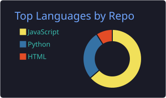
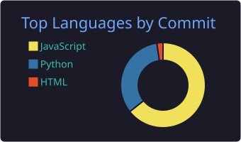

<h1 align="center">
  
</h1>

  <em>Passionate developer building modern web applications and contributing to open source.</em>

---

### 🚀 Tech Stack

  

---

### 📊 GitHub Stats

  

  
  

---

### 🐍 Contribution Activity

  

---

### 📫 Connect with Me

  

